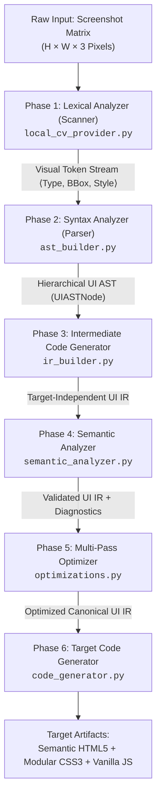

# UI2Code: Compiler Design Architecture & Academic Defense Guide
**Course:** BCSE307P – Compiler Design Lab  
**Institution:** Vellore Institute of Technology (VIT), Vellore  
**Project:** UI2Code – Compiler-Assisted Visual-to-Web Code Generation System  

---

## 1. Executive Summary: Why UI2Code is a Real Compiler (Not Generative AI)

When defending this project to faculty, the core question will be:  
> *"Is this just an AI API wrapper or script that guesses HTML?"*

The answer is an unequivocal **NO**. UI2Code is an authentic, multi-pass **optimizing compiler system** based on the classical compiler design principles outlined in the *Dragon Book* (*Compilers: Principles, Techniques, and Tools* by Aho, Lam, Sethi, and Ullman).

### The Key Difference: Deterministic Compiler vs. Black-Box AI

| Metric / Dimension | UI2Code (Compiler + Computer Vision) | Generative AI (LLMs / Vision APIs) |
| :--- | :--- | :--- |
| **Execution Model** | **Deterministic multi-pass pipeline:** Lexer &rarr; Parser &rarr; AST &rarr; IR &rarr; Semantic Analyzer &rarr; Optimizer &rarr; Code Generator. | **Probabilistic next-token sampling:** Output varies by random seed and temperature. |
| **Reproducibility** | **100% Deterministic:** Identical input screenshot always yields the exact same AST, IR, and code. | **Non-deterministic:** Repeated queries produce different tag structures, classes, and styles. |
| **Hallucination Risk** | **Zero:** Elements are emitted *only* when physical pixel evidence (contours, edges, color contrast) is detected. Single button in &rarr; single button out. | **High:** Frequently invents fake navbars, marketing text ("Lorem ipsum", "Get Started"), or full landing pages. |
| **Intermediate Representation (IR)** | **Explicit, typed, inspectable `UIIR`:** Contains canonical layout tree, CSS style tokens, and layout directives. | **Opaque latent space:** Uninterpretable float16/bfloat16 activation vectors. |
| **Optimization Passes** | **Formal Compiler Passes:** Common Subexpression Elimination (CSE) for styles, dead-wrapper elimination, and pattern hoisting. | **None:** Relies on whatever structure the model happened to emit. |
| **Cost & Privacy** | **100% Free & Offline:** Runs locally on CPU using OpenCV, NumPy, and Python. Zero cloud bills or rate limits. | **Expensive:** Requires paid cloud vision APIs (e.g., \$0.01–\$0.05 per screenshot) and internet connectivity. |
| **Formal Verification** | **Pixel-difference verification:** Computes Mean Absolute Error (MAE) and visual diff heatmap between source and rendered DOM. | **None:** Relies entirely on manual human inspection. |

---

## 2. Dragon Book Compiler Phases Mapped to UI2Code

### Phase 1: Lexical Analysis (Visual Scanner)
- **Module:** `backend/app/vision/local_cv_provider.py`
- **Compiler Principle:** In standard compilers, the scanner reads a stream of characters $c_1, c_2, \dots \in \Sigma^*$ and groups them into lexemes matching regular definitions to produce tokens. In UI2Code, the source text is a 2D spatial pixel matrix $I \in \mathbb{R}^{H \times W \times 3}$.
- **Mechanism:**
  1. Image preprocessing: Grayscale conversion, Gaussian blurring, Sobel gradient projection, and Otsu/Canny edge detection.
  2. Background estimation: Samples perimeter border pixels to determine the canvas background color and luminance.
  3. Contour extraction: `cv2.findContours` detects connected component boundaries.
  4. Non-Maximum Suppression (NMS): Removes duplicate boundary rings while preserving nested children.
  5. Token classification: Bounding boxes are classified by geometric aspect ratio, area percentage, color uniformity, and gradient variance into discrete **Visual Tokens**:
     $$\text{Token} = \langle \text{Type}, \text{BoundingBox}(x, y, w, h), \text{StyleAttributes}, \text{Confidence} \rangle$$
  6. **Data-driven guarantee:** If the screenshot contains only 1 button, the scanner emits *only 1 button token*. It never injects synthetic headers, navbars, or footers.

### Phase 2: Syntax Analysis (Hierarchical AST Construction)
- **Module:** `backend/app/compiler/ast_builder.py`
- **Compiler Principle:** The parser consumes the flat token stream and verifies if the arrangement satisfies the grammar rules, constructing an Abstract Syntax Tree (AST).
- **2D Spatial Containment Grammar:**
  $$\text{Page} \to (\text{Container} \mid \text{Leaf})^*$$
  $$\text{Container} \to \text{Header} \mid \text{Footer} \mid \text{Section} \mid \text{Card} \mid \text{Form} \mid \text{Container}$$
  $$\text{Leaf} \to \text{Button} \mid \text{Input} \mid \text{Heading} \mid \text{Text} \mid \text{Image} \mid \text{Link}$$
- **Grammar Reduction:**
  - Node $A$ is the parent of node $B$ ($B \in \text{children}(A)$) if and only if $\text{bbox}(B) \subseteq \text{bbox}(A)$ and $A$ is the smallest containing bounding box.
  - Type constraints: A leaf node cannot contain other elements ($\text{Button} \not\to \text{Button}$).
  - Reading order: Children within any container are sorted in canonical visual reading order (top-to-bottom, left-to-right).

### Phase 3: Intermediate Code Generation (IR Builder)
- **Module:** `backend/app/compiler/ir_builder.py`
- **Compiler Principle:** An Intermediate Representation (IR) decouples the frontend language/format from the target architecture. It enables machine-independent optimizations.
- **Mechanism:**
  - Converts `UIASTNode` into `UIIRNode` and `UIIR`.
  - **Layout Inference:** Infers modern flexbox/grid layout strategies:
    - Children aligned horizontally ($\Delta y \approx 0, \text{varying } x$) &rarr; `layout: flex-row`.
    - Children aligned vertically ($\Delta x \approx 0, \text{varying } y$) &rarr; `layout: flex-column`.
    - 2D grid matrix of items &rarr; `layout: flex-wrap` / `grid`.
  - Tokenizes CSS styles into atomic class identifiers (`ui2c-button-1`, `ui2c-card-2`).

### Phase 4: Semantic Analysis (Static Type & Constraint Checker)
- **Module:** `backend/app/compiler/semantic_analyzer.py`
- **Compiler Principle:** Validates semantic correctness that syntax grammars cannot easily capture (type checking, scope resolution, accessibility constraints).
- **Rules Checked:**
  1. **Node Identity:** Enforces global uniqueness of node IDs (Error if duplicate).
  2. **Cycle Prevention:** Proves tree acyclicity (Error if cyclic graph).
  3. **Containment Validity:** Prohibits semantic violations (e.g., Button inside Button, Link inside Link, Header inside Card).
  4. **Accessibility Constraints:** Checks that interactive buttons and links have accessible text labels or icons.
  5. **Noise Filtering:** Detects bounding boxes smaller than minimum viable thresholds ($< 0.05\%$ of canvas).

### Phase 5: Compiler Optimization Passes (IR-to-IR Transformations)
- **Module:** `backend/app/compiler/optimizations.py`
- **Compiler Principle:** Deterministic rewrite rules that improve code efficiency, eliminate redundancy, and reduce size without changing program semantics.
- **Implemented Passes:**
  1. **Style Normalization Pass:** Canonicalizes 3-digit hex to 6-digit hex (`#fff` &rarr; `#ffffff`), standardizes measurement units (converts floating points to clean pixels/percentages), and removes redundant default styles.
  2. **Duplicate Style Elimination (CSS Common Subexpression Elimination):** Scans all nodes across the AST. When multiple nodes share identical style attribute dictionaries, the optimizer hoists the style into `style_tokens` as a shared CSS class (`.shared-style-1`) and replaces individual inline rules with the shared class.
  3. **Repeated Pattern Recognition Pass:** Detects sibling nodes of identical type and compatible style signatures (e.g. 3 feature cards in a row). Assigns unified grouping tokens (`card-group-1`) without removing any elements.
  4. **Safe Wrapper Simplification Pass (Dead Code Elimination):** Eliminates redundant `
` wrapper containers if and only if the container has exactly 1 child, has no background, border, or explicit layout rules, and has no semantic role.
  5. **Layout Simplification Pass:** When children inside a flex container share uniform spacing, the optimizer hoists the gap property directly onto the parent container (`gap: 16px`).

### Phase 6: Target Code Generation (Backend Emitter)
- **Module:** `backend/app/compiler/code_generator.py`
- **Compiler Principle:** Traverses the optimized IR and emits the target instruction stream.
- **Generated Target Languages:**
  1. **HTML5:** Semantic W3C document (`<!DOCTYPE html>`, `<header>`, `<main>`, `<section>`, `<button>`, `<input>`) with full data traceability attributes (`data-ui2c-id`) linking every DOM element back to its IR node ID.
  2. **CSS3:** Modern CSS reset, responsive viewport scaling, shared token classes, flexbox layout rules, and clean kebab-case properties.
  3. **Vanilla JavaScript:** Event listener scaffolding with `DOMContentLoaded` ensuring interactive event handlers for buttons and forms.

---

## 3. Academic Viva Defense Cheat Sheet (FAQ)

### Q1: "Why did you build a compiler instead of prompting ChatGPT or Claude to write HTML?"
> **Answer:**  
> "Generative AI is inherently non-deterministic, hallucinatory, and operates as an opaque black box. When you give ChatGPT an image of a single button, it frequently hallucinates a full landing page with fake navigation links, marketing slogans, and synthetic footers. Furthermore, LLMs cannot provide formal guarantees about structural containment or duplicate code elimination, and every API call incurs monetary cost and latency.  
> Our project, **UI2Code**, treats visual code generation as a formal **compiler problem**. By utilizing Computer Vision as a visual scanner, we achieve 100% deterministic, offline, free token extraction. Every subsequent phase—Parsing, IR generation, Semantic Analysis, and Optimization—is inspectable, mathematically reproducible, and follows textbook compiler theory."

### Q2: "How does an image serve as a formal input to a lexical analyzer?"
> **Answer:**  
> "In traditional textual compilers, the input is a 1-dimensional array of ASCII/Unicode characters $c \in \Sigma$. In visual compilers, the input is a 2-dimensional matrix of pixel values $I \in \mathbb{R}^{H \times W \times 3}$.  
> In standard lexers, regular expressions identify keywords and identifiers based on character transitions. In our visual lexer (`local_cv_provider.py`), Sobel spatial gradients, Canny edge detection, and OpenCV contour segmentation identify geometric transitions. The scanner outputs discrete `DetectedElement` tokens with attributes $\langle \text{type}, \text{bbox}, \text{style}, \text{confidence} \rangle$."

### Q3: "What is your grammar, and how does your parser construct the AST?"
> **Answer:**  
> "We define a **2D Spatial Containment Grammar**. Unlike textual languages where nesting is denoted by parentheses or curly braces `{ }`, visual UI nesting is denoted by physical geometric inclusion on the Cartesian plane.  
> Node $B$ is a child of node $A$ if and only if $\text{bbox}(B) \subseteq \text{bbox}(A)$ with tolerance $\epsilon$. Our parser (`ast_builder.py`) sorts tokens by bounding box area and constructs a parent-pointer tree, enforcing semantic type constraints (e.g. an interactive `<button>` is a leaf terminal and cannot derive child elements like `<header>` or `<page>`)."

### Q4: "Why did you design an Intermediate Representation (IR)? Why not emit HTML directly from the AST?"
> **Answer:**  
> "Direct code emission from an AST is an anti-pattern in compiler design because it tightly couples the frontend parser to the target syntax and prevents multi-pass optimizations.  
> Our `UIIR` canonicalizes layout strategies (inferring flexbox row vs column vs grid), isolates coordinates, and establishes CSS class tokens. More importantly, having an IR allows our 5 optimization passes (Style Normalization, Common Subexpression Elimination, Dead Wrapper Elimination) to transform the program before code generation. In the future, the same IR can emit React JSX, Vue SFCs, or Flutter widgets without modifying the visual scanner or parser."

### Q5: "What compiler optimizations did you implement, and what are their classical equivalents?"
> **Answer:**  
> "We implement five deterministic passes in `optimizations.py`:
> 1. **Style Normalization:** Equivalent to Constant Folding / Canonicalization.
> 2. **Duplicate Style Elimination:** Equivalent to **Common Subexpression Elimination (CSE)**. When multiple elements compute identical style tuples, we hoist them into a single CSS rule in the token table.
> 3. **Repeated Pattern Recognition:** Equivalent to Loop / Isomorphic Subgraph Identification.
> 4. **Safe Wrapper Simplification:** Equivalent to **Dead Code Elimination (DCE)**. We remove single-child wrapper `
` nodes that contribute zero styling or semantic value.
> 5. **Layout Simplification:** Equivalent to Expression Hoisting."

### Q6: "How do you verify that the generated code actually matches the input screenshot?"
> **Answer:**  
> "We implement a formal verification endpoint (`/api/verify`). The system renders the generated HTML/CSS in a headless canvas and compares it pixel-by-pixel against the source screenshot. We compute the **Mean Absolute Error (MAE)** across all RGB channels and generate a visual pixel difference heatmap. This provides an objective, mathematical metric of compilation fidelity."
